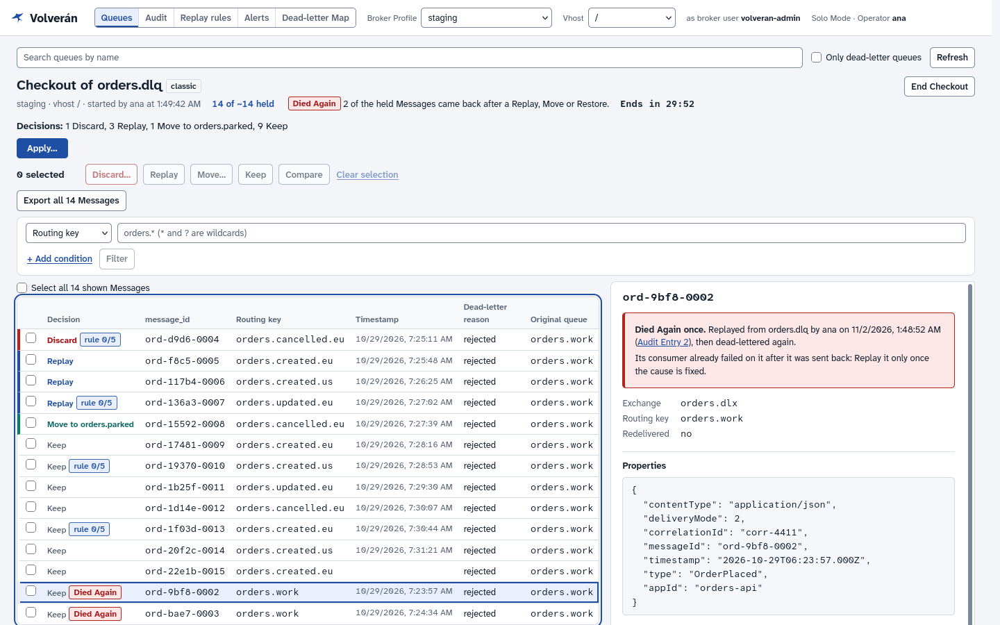
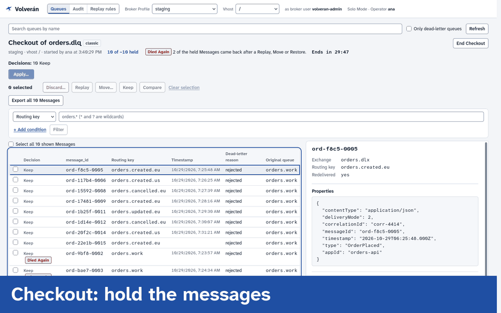
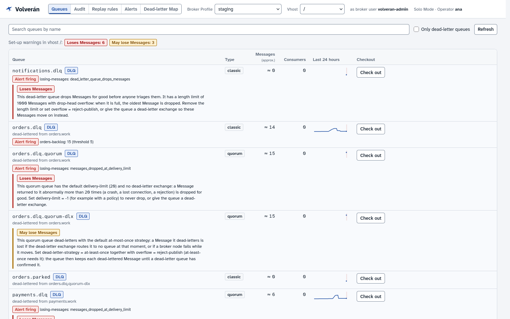
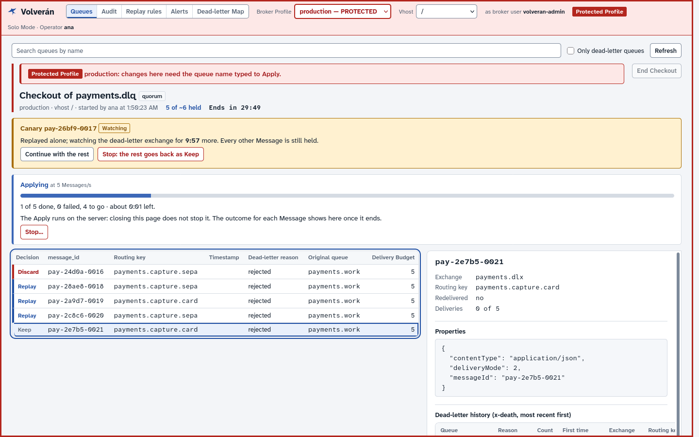
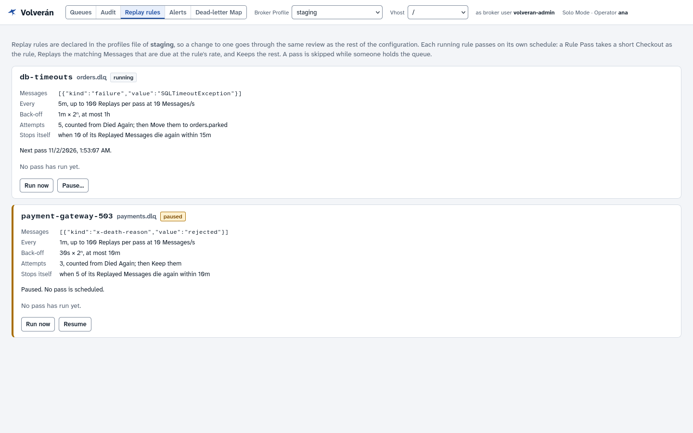
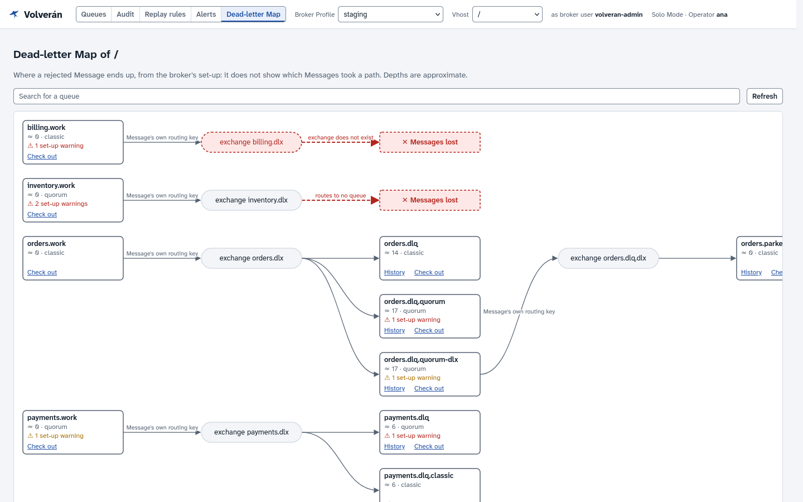
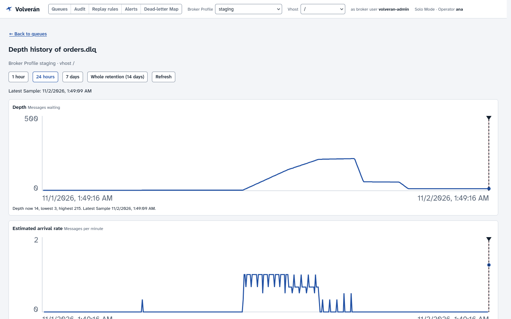
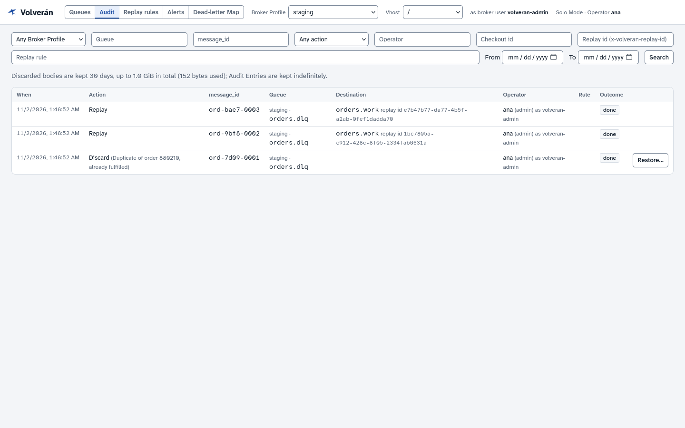

<p align="center">
  
</p>

<h1 align="center">Volverán</h1>

<p align="center"><strong>Dead letters come back.</strong><br>
<em>Volverán las oscuras golondrinas…</em> (Gustavo Adolfo Bécquer)</p>

<p align="center">
  <a href="https://github.com/volveran/volveran/releases/latest"></a>
  <a href="https://github.com/volveran/volveran/actions/workflows/ci.yml"></a>
  <a href="LICENSE"></a>
</p>

Your dead-letter queue has hundreds of messages in it and the incident is finally over. Some should go back, some should go to the bin, and a few need a human. Volverán is an open-source, self-hosted tool for RabbitMQ that holds those messages still while you look at them, lets you decide what happens to each one, and carries it all out in one step.

<picture>
  <source media="(prefers-color-scheme: dark)" srcset="docs/images/checkout-dark.png">
  
</picture>

## Why

The RabbitMQ management UI can peek at a queue, purge all of it, or shovel all of it somewhere else. Real dead-letter work is different: delete these 12, send these 40 back where they came from, move these 3 to a manual-handling queue, and keep a record of who did what.

Peeking is not free either. Every peek requeues the message, and on quorum queues a requeue can use up one of its delivery attempts. Look at a queue often enough and you can lose the very messages you were trying to save.

| | Management UI | Volverán |
|---|---|---|
| Looking at a message | Requeues it | Holds it, and nothing is requeued while you look |
| Others acting on the same messages | Possible | Kept away until you finish |
| Different actions in one go | No | Discard, Replay, Move and Keep, applied together |
| A record of who did what | No | Every action, with who approved it |
| Undoing a delete | No | Discarded messages can be Restored |

[How Volverán compares](docs/comparison.md) with other tools for RabbitMQ messages.

## How it works

<picture>
  <source media="(prefers-color-scheme: dark)" srcset="docs/images/flow-dark.gif">
  
</picture>

1. **Checkout.** Volverán takes the Messages at the head of a dead-letter queue and holds them, unacknowledged. If Volverán or your browser dies, the broker returns every held Message to the queue.
2. **Decide.** Filter and select Messages, then give each one a Decision: **Discard**, **Replay** (back to the queue it was dead-lettered from), **Move** (to another queue or exchange) or **Keep**. A Message that came back after you sent it out is flagged **Died Again**, so you don't Replay the same poison Message over and over. All of it works from the keyboard, and no key Applies.
3. **Apply.** Every Decision is carried out in one step, in the background, and you see the outcome for every Message.
4. **Audit and Restore.** Every action is recorded with who did it. Discarded Messages are kept so they can be Restored.

The queue list also warns about the ways the broker silently loses Messages: a dead-letter exchange that is missing or routes nowhere, a dead-letter queue whose TTL or length limit drops them, and more.

<picture>
  <source media="(prefers-color-scheme: dark)" srcset="docs/images/queues-dark.png">
  
</picture>

Messages that Spring AMQP or MassTransit gave up on carry no `x-death`. Volverán reads the failure details these frameworks write instead: the exception, the stack trace and the original queue ([guide](docs/spring-amqp-and-masstransit.md)). You can also compare two Messages side by side and export held Messages as [lossless NDJSON](docs/exporting.md).

## Replay at scale

The consumer has often only just recovered when the Replay starts. Sending everything back at once is how you get the second incident.

- **Replay Rate** limits how fast Messages go back.
- **Canary** Replays one Message first and waits while you see whether it dies again.
- **Stop** an Apply part way, and the rest goes back to the queue.

<picture>
  <source media="(prefers-color-scheme: dark)" srcset="docs/images/canary-dark.png">
  
</picture>

**Replay rules** take the routine cases off your hands. Declared per Broker Profile in the profiles file, a rule Replays the matching Messages of one queue on a schedule, with back-off and an attempt limit, and pauses itself when its Replays keep dying again ([guide](docs/replay-rules.md)).

<picture>
  <source media="(prefers-color-scheme: dark)" srcset="docs/images/rules-dark.png">
  
</picture>

## Know before anyone asks

Between visits, Volverán keeps watch. None of it needs a Checkout or reads a Message ([guide](docs/observability.md)).

- **Depth history** samples every dead-letter queue once a minute and keeps 14 days, with estimated arrivals and marks for each Apply that took Messages out.
- **Alerts** go to Slack, Microsoft Teams or a signed webhook when a queue grows, Messages arrive, a Replay rule pauses or a queue starts losing Messages. Rules live in the profiles file, so a change goes through review.
- **Prometheus metrics** on a port of their own, with a `ServiceMonitor` in the Helm chart. A scrape never contacts a broker.
- **The Dead-letter Map** shows which queues dead-letter into which, with the losses, chains and cycles.

<picture>
  <source media="(prefers-color-scheme: dark)" srcset="docs/images/map-dark.png">
  
</picture>

<picture>
  <source media="(prefers-color-scheme: dark)" srcset="docs/images/history-dark.png">
  
</picture>

## Built for teams

Run it on your laptop in **Solo Mode**, or as a shared service in **Team Mode**, with single sign-on through any OIDC provider (Keycloak, JumpCloud, Okta, Entra ID).

- **Protected Profiles** frame production in red and need the queue name typed before anything changes.
- **Approval** makes a second Operator confirm an Apply on a Protected Profile.
- **Roles** map your OIDC groups to `viewer`, `operator` or `admin`, per Broker Profile.
- **Your own permissions**: a Broker Profile can connect with each Operator's OAuth 2.0 token, so RabbitMQ applies their permissions.
- **Audit**: searchable, kept indefinitely, with who did it and who approved it.

<picture>
  <source media="(prefers-color-scheme: dark)" srcset="docs/images/audit-dark.png">
  
</picture>

## Safe by design

- **At-least-once settling.** A failure can create a duplicate, but never loses a Message ([why](docs/adr/0001-apply-settles-each-message-at-least-once.md)).
- **Durable before it's gone.** A Discarded Message is written to disk before the broker is told to drop it.
- **Tested against a real broker.** Every [RabbitMQ behaviour](docs/rabbitmq-behaviour.md) Volverán relies on has a test, run on every change and weekly against the latest RabbitMQ 4.
- **Signed releases.** The image and Helm chart are signed with keyless cosign, and the image carries an SBOM and provenance.
- **Small footprint.** One read-only container that writes only to its audit volume. Solo Mode refuses to listen on anything but loopback.

## Quick start

Write `profiles.yaml` from [`profiles.example.yaml`](profiles.example.yaml). Each Broker Profile names the environment variable holding its password, so passwords never go in the file. Then:

```sh
export VOLVERAN_DEV_PASSWORD=guest
docker run --rm --read-only --network host \
  -v "$PWD/profiles.yaml:/config/profiles.yaml:ro" \
  -v volveran-data:/data \
  -e VOLVERAN_OPERATOR="$USER" \
  -e VOLVERAN_DEV_PASSWORD \
  ghcr.io/volveran/volveran:1.0.0-rc.1
```

Open <http://127.0.0.1:8080>. Keep the `volveran-data` volume: it holds the audit trail and every Discarded Message. On Docker Desktop, turn on host networking first ([details](docs/configuration.md#why-solo-mode-uses-the-host-network)). With Compose, use [`docker-compose.example.yml`](docker-compose.example.yml).

**Team Mode:** see the [Team Mode guide](docs/team-mode.md).

**Kubernetes:** a signed Helm chart, also with a [Flux CD example](examples/flux/). See the [Kubernetes guide](docs/kubernetes.md).

```sh
helm install volveran oci://ghcr.io/volveran/charts/volveran --version 1.0.0-rc.1 \
  --namespace volveran -f values.yaml
```

## Where it's going

Volverán 1.0 is in release candidates. It brings several Replicas, a stable configuration format, [upgrade guarantees](docs/compatibility.md) and a [security review](docs/security-review.md) done by the project itself. Coming from 0.x, read the [upgrade guide](docs/upgrading-to-1.0.md). What comes after is in the [roadmap](ROADMAP.md).

## Learn more

- [Observability](docs/observability.md): sizing, Alert Rules, the webhook schema and the metric reference.
- [Configuration](docs/configuration.md): every setting and the health checks.
- [Running several Replicas](docs/replicas.md): setting it up, what failover protects and not, and what was tested.
- [Upgrading from 0.x to 1.0](docs/upgrading-to-1.0.md): everything 1.0 refuses, and what to do about it first.
- [Compatibility policy](docs/compatibility.md): what a version may change, supported upgrades, and the RabbitMQ, PostgreSQL, Kubernetes and Node versions tested.
- [PostgreSQL](docs/postgresql.md): keeping the audit store in your own database, with TLS, what happens when it goes away, and sizing.
- [Replaying many Messages](docs/replaying.md), [Exporting Messages](docs/exporting.md).
- [Glossary](GLOSSARY.md): the vocabulary used everywhere in Volverán.
- [Security review](docs/security-review.md): who did it, what was tested and what was not. [Threat model](docs/threat-model.md): what Volverán protects, each result in full, and the risks it accepts.
- [Architecture decisions](docs/adr/).
- [Changelog](CHANGELOG.md).
- [Contributing](CONTRIBUTING.md): development, tests and releases.

## License

[Apache License 2.0](LICENSE).

RabbitMQ is a trademark of Broadcom Inc. Volverán is not affiliated with or endorsed by Broadcom.
